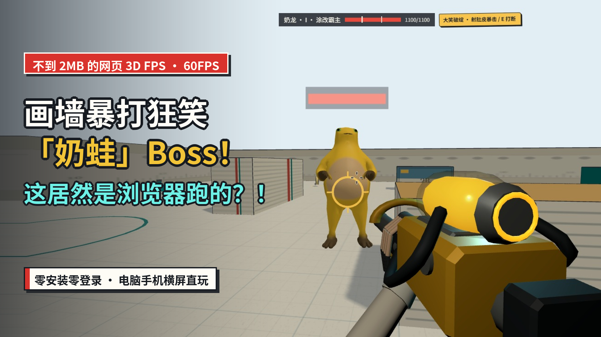
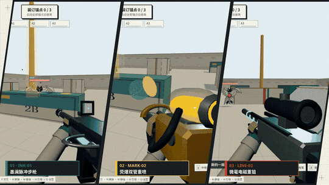
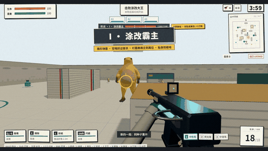

# 墨线突围 · INKLINE

手绘纸艺 3D 战术射击。把书桌文具变成战场，用三把文具枪、画墙与折纸地形，在装订锚点、墨潮小怪和「奶蛙（涂改大王 · 原创 3D 首领）」之间杀出一条撤离路线。



**在线试玩（公网 HTTPS，无需登录，电脑/手机双端直玩）**
<https://inkline-oic6hre1kvo.qoder.website>

支持电脑端键鼠锁定畅玩与手机端全兼容强制横屏双摇杆触控（系统锁定竖屏时自动旋转 90° 满屏横屏渲染）。也可直接在 [Releases](https://github.com/Spongebob001-star/inkline-paper-fps/releases) 下载 `< 2 MiB` 离线单文件 `inkline.html`（断网双击即玩）与 `1080p@60fps` 横版实机宣传片。

### 实机动图预览

| 三把文具枪 & 墨线战术 | 单挑捧腹狂笑「奶蛙」Boss |
| :---: | :---: |
|  |  |

## 亮点

- **书桌纸艺奇境**：巨大的铅笔塔、直尺拱门、回形针与便签塔，配纸云、纸板书封皮肤和墙面装饰，构成完整的桌面微缩战场。
- **三把 PBR 文具枪 + 第一人称双手**：中性笔、荧光笔、针管笔三套枪械各 22–24 个部件，右手握持、左手支撑 / 泵动，带换弹、后坐、枪口焰与墨迹反馈。
- **画墙、速墙、擦除、折纸改地形**：消耗墨水实时画墙挡弹，折页可在坡道与平台之间切换，擦除敌方墨迹与危险区域。
- **锚点 Roguelike 强化**：启动 A1–A3 三个装订锚点，每次从三选一强化中构筑本局流派。
- **「涂改大王（原创 3D 首领）」**：3 阶段、5 类技能，含双层交错扇形弹幕、音浪震波、天降墨雨、连环折返冲锋与近身砸地；支持跳跃 / 折页高台躲音浪、画墙断冲锋。
- **单人「墨力自救」与闪避跳躲**：权威判定的 Shift 墨迹闪避，配合 0.55m 音浪跃过窗口；单人模式每局首次倒地可按住 `F` 2 秒自救起身（50 血 + 1s 无敌），用尽后二次倒地直接结算，彻底消除单人干等 20s 的矛盾。
- **移动端强制横屏双摇杆适配**：支持 `html.force-landscape` CSS 90° 强制横屏容器 + 触控坐标 90° 逆映射，多指 `identifier` 隔离（左摇杆满圈自动冲刺、右屏及拖动开火键跟枪、底部直点切枪与技能、长按横幅锚点/自救）。
- **单文件、离线、低于 2 MiB 预算**：`dist/inkline.html` 可在 `file://` 下双击游玩，运行期零网络请求。
- **810 条自动化测试全绿**：内核、协议、渲染、HUD、音频、移动端触控、构建与离线整局验收全部纳入回归。

## 快速上手

- **电脑键鼠**：
  1. 打开在线地址，点击「进入战场 ↗」并允许鼠标锁定（按 Esc 释放）。
  2. `WASD` 移动，`Shift` 闪避，左键射击，`1/2/3` 或滚轮切枪，右键开镜，`R` 换弹。
  3. 靠近装订锚点，按住 `F` 启动 A1–A3；每启动一个锚点选择一项强化。
  4. 「涂改大王（原创 3D 首领）」登场后，用 `Q / G` 画墙、`C` 折纸、`E` 擦除和闪避处理五类技能。
  5. 单人模式首次倒地可按住 `F` 2 秒「墨力自救」（每局 1 次）；击败首领后出口解锁，前往出口按住 `F` 撤离，结算根据用时、生命、暴击与打断给出 S / A / B 评级。
- **手机触屏**：
  1. 手机浏览器打开后点击「进入战场 ↗」，自动适配横屏与双摇杆布局（系统竖屏锁定状态下亦自动横置满屏）。
  2. 左拇指推摇杆移动（推满外圈自动冲刺），右半屏划动或按住红色圆钮「开火」拖动跟枪，点击底部武器与能力卡片直接切枪、速墙、擦除、折纸或闪避，靠近锚点/自救提示条时直接长按触发。

## 本地运行

直接游玩：

```bash
# 双击或用浏览器打开构建产物（无需服务器、无需联网）
dist/inkline.html
```

开发预览（需要从项目根目录启动静态服务器，ES Module 才能正常加载）：

```bash
python -m http.server 8080
# 打开 http://127.0.0.1:8080/dev/client.html
```

Windows 上如果没有 `python`，可用 `py -3 -m http.server 8080`，或任意以项目根目录为根的静态服务器。

## 构建与测试

```bash
npm test                          # 810 条测试，0 失败 / 0 跳过
node client/build.mjs --selftest  # 构建器自检与依赖环检查
node client/build.mjs             # 生成 dist/inkline.html
node tests/offline-playthrough.mjs # 断网 file:// 整局通关验收
```

构建约束：产物必须小于 `2,097,152 B`。当前产物 `2,052,893 B`，余量 `44,259 B`。

## 项目结构

| 路径 | 说明 |
| --- | --- |
| `dev/client.html` | 开发入口与桌面/移动端强制横屏响应式样式、锁鼠入口卡片 |
| `client/` | 渲染、HUD、键鼠/双摇杆触控输入、音频、动态 BGM、设置、单文件构建器 |
| `shared/` | 20Hz 确定性内核：模拟、Boss、敌人、锚点、折页、强化、单人自救/救援、世界 |
| `host/` | 本地房主运行时、快照与输入权威 |
| `src/three/` | Three.js UMD 运行时（构建时内联） |
| `src/models/` | 原创 Blender 模型与动画 GLB、内联模型数据 |
| `src/audio/` | Boss 笑声等内联音频素材（其余战场音效由 WebAudio 实时合成） |
| `dist/inkline.html` | 最终单文件产物 |
| `site/index.html` | 公网发布用的单文件副本，与 `dist` 逐字节一致 |
| `promo/INKLINE-Cover-16x9.png` | 16:9 横版宣传封面图 |
| `promo/forum-media/` | 精选实机截图、实战动图 GIF、Boss 骨骼与动作展示图（60fps 横版宣传片归档于 GitHub Release） |
| `tests/` | 单元、集成、内核确定性、移动端触控、浏览器与离线整局验收 |
| `docs/` | 接口契约与阶段记录文档 |

## 技术要点

- **确定性 20Hz 权威内核**：`shared/` 与 `host/runtime.mjs` 负责固定步长模拟与快照；客户端在快照之间插值渲染，保证单人、联机与自动化验收走同一条逻辑路径。
- **零依赖单文件构建**：`client/build.mjs` 自行完成模块图、循环依赖检查、模型 / 音频 / Three.js 内联与体积预算控制，不依赖打包器或运行时网络。
- **原创 Blender Boss 管线**：「涂改大王（原创 3D 首领）」从建模与拓扑整理，到 20 根骨骼（Root + 19 根变形骨）绑定、表面测地蒙皮、LOD0 / LOD2 双档导出，再到 6 段骨骼动画（Idle / Move / Attack / LaughAttack / Hit / Death），全部由 Blender 资产管线产出并接入 Three.js `AnimationMixer`。
- **全套 WebAudio 战场**：枪声、换弹、脚步、闪避、锚点、Boss 技能与动态 BGM 均由 WebAudio 实时合成 / 播放，点击进入后解锁音频上下文。

## 当前验收状态（v1.0.0 完结版 · 2026-11-26）

- `npm test`：810 通过，0 失败，0 跳过。
- 单文件：`2,052,893 B`，低于 2 MiB 上限，余量 `44,259 B`。
- 离线整局：`file://` 通关，外部请求与加载失败均为空，控制台零错误。
- 双端与宣传片：桌面端键鼠锁鼠及三武器/双手/Boss/动态 BGM 正常；移动端 `html.force-landscape` + 触控坐标 90° 逆映射在 `640×360` 视口零重叠通过，单人首次倒地可 2s「墨力自救」；`1920×1080 @ 60fps` 横版实机宣传片结尾二维码已解码核验指向在线站点并归档至 Release。

## 操作一览

| 输入（电脑 / 手机） | 行为 |
| --- | --- |
| `WASD` / 左摇杆 | 移动（手机推满摇杆外圈自动冲刺） |
| 左键 / 右下角红钮「开火」 | 射击 / 按住连发（手机支持按住并拖动瞄准） |
| 右键 / 「镜」按钮 | 开镜（针管笔） |
| `Shift` / 点击「闪避」卡 | 墨迹闪避 |
| `Space` / 「跃」按钮 | 跳跃 |
| `1 / 2 / 3`、滚轮 / 点击武器标签 | 切换中性笔 / 荧光笔 / 针管笔 |
| `Q` / `G` / 「速墙」或点击「画墙」卡 | 画墙 / 快速画墙 |
| `E` / 点击「擦除」卡 | 擦除 |
| `C` / 点击「折纸」卡 | 折纸改地形 |
| `F` / 长按提示条或倒地横幅 | 启动锚点 / 撤离 / 单人首次倒地墨力自救 |
| `R` / 「换」按钮 | 换弹 |
| `M` / `O` / `H` | 静音 / 设置 / 引导 |

---

在线地址：<https://inkline-oic6hre1kvo.qoder.website>
